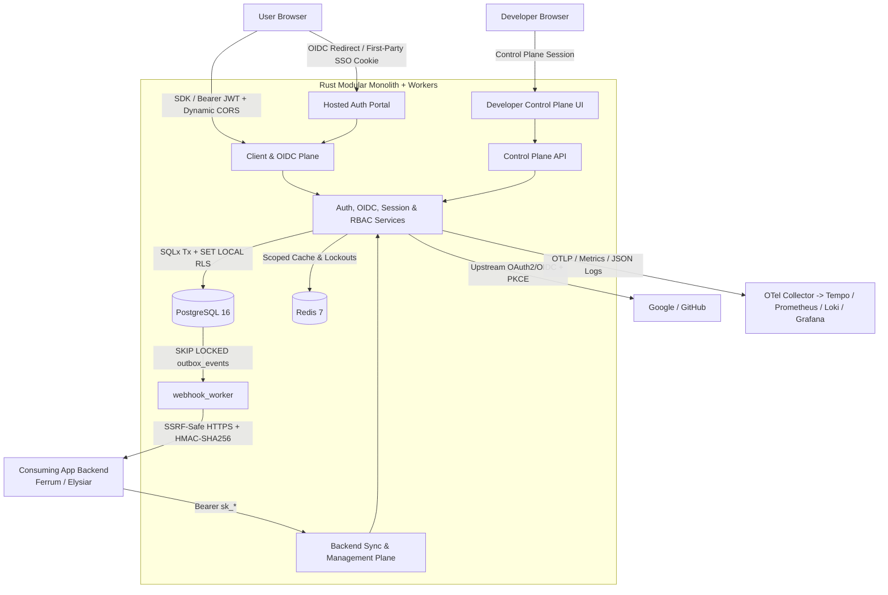

# System Architecture

## 1. Overview

`secure-auth-platform` is a multi-tenant **Identity Infrastructure Platform** combining Clerk-style developer ergonomics (publishable/secret keys, isolated dev/prod environments, drop-in TypeScript SDKs, organizations, webhooks, and self-service dashboard) with a standards-compliant **Central OpenID Connect (OIDC) Identity Provider** supporting cross-application Single Sign-On and deterministic 4-layer synchronization with consuming services.

The system is designed as a **Modular Monolith** (`apps/auth-api` in Rust/Axum) paired with independently deployable supporting workers (`webhook_worker`), two clearly separated SvelteKit 5 web surfaces (**Hosted Auth Portal** and **Developer Control Plane Dashboard**), and runtime-agnostic TypeScript SDKs (`packages/*`).



---

## 2. Three-Plane API & Trust Boundaries

See [ADR-006](./adr/0006-three-plane-api-and-versioning.md) for the formal decision record.

| Plane | Base Paths | Caller | Auth & Middleware |
| --- | --- | --- | --- |
| **OIDC & Discovery** | `/.well-known/openid-configuration`, `/.well-known/jwks.json`, `/oauth2/*` | Browsers, Hosted Portal, OIDC relying parties | First-party `__Host-idp_sso_session` cookie (IdP origin), PKCE `S256`, `client_id`, exact `redirect_uri` |
| **Client / Frontend API** | `/v1/client/*` | Browser SDKs (`@secure-auth/*`) | `pk_test_*` / `pk_live_*`, dynamic per-environment CORS, `aud`-scoped asymmetric access JWT |
| **Backend Sync & Management API** | `/v1/backend/*` | Consuming backends (Ferrum API, Elysiar API) | Scoped `sk_test_*` / `sk_live_*` Bearer keys, zero cookies/CSRF |
| **Developer Control Plane API** | `/v1/control/*` | Developer Dashboard (`apps/web`) | Developer session + workspace RBAC (`owner`, `admin`, `developer`, `viewer`), strict CSRF |

### Trust Boundaries
1. **Untrusted Browser -> Platform:** Browsers only ever receive `pk_*` publishable keys, short-lived `aud`-scoped access tokens, or first-party `HttpOnly` cookies on the IdP origin. Secret keys (`sk_*`), webhook signing secrets (`whsec_*`), OAuth client secrets, and asymmetric signing private keys never reach browsers.
2. **Consuming App Backend -> Platform:** Consuming backends verify end-user tokens locally using `/.well-known/jwks.json` (strictly validating `iss`, `aud`, `exp`, `kid`, `typ`) and authenticate server-to-server sync/management calls with hashed, scoped `sk_*` keys.
3. **Platform Worker -> External Webhook URLs:** `webhook_worker` treats developer-registered webhook URLs as untrusted egress targets, enforcing HTTPS (in prod), connection-time IP validation (blocking loopback/RFC1918/link-local/metadata ranges), disabled redirects, and strict timeouts.
4. **Tenant Boundary Inside PostgreSQL & Redis:** Every tenant-owned record belongs to an `environment_id` (see [ADR-001](./adr/0001-application-environments-as-tenant-boundary.md)). Composite foreign keys, transaction-scoped `SET LOCAL` RLS, and explicit `env:{environment_id}:` vs. `idp:global:` Redis key prefixes enforce isolation across both applications and `dev`/`prod` environments.

---

## 3. Frontend Surface Separation (`apps/web`)

Although both surfaces initially share the SvelteKit 5 + Svelte 5 component library (`Button`, `Card`, `Input`, `Modal`, `Navbar`, `Toast`, `Badge`), they are architecturally isolated:

1. **Hosted Auth Portal (`accounts.<domain>` / `/portal/*`, `/oauth/*`):**
   - End-user sign-in, sign-up, OTP verification, password reset, first-time app consent ("Continue to Elysiar as..."), and personal SSO session management.
   - Dynamically branded per `application_environments.branding`.
   - Enforces `Content-Security-Policy: frame-ancestors 'none'` and `X-Frame-Options: DENY`.
2. **Developer Control Plane Dashboard (`dashboard.<domain>` / `/dashboard/*`):**
   - Developer authentication, Workspace -> Application -> Environment (`Development` / `Production`) switcher, API keys, domains/CORS, OAuth/OIDC policy config, end-user directory, webhook debugger/replay, organizations, RBAC editor, audit logs, and analytics.

---

## 4. Backend Layered Structure (`apps/auth-api`)

```text
apps/auth-api/src/
├── config/        # Typed environment configuration & validation
├── errors/        # Unified AppError & ApiErrorEnvelope (code, message, request_id, details)
├── models/        # Domain models, strong ID newtypes, DomainEventEnvelope
├── repositories/  # PostgreSQL (with explicit sqlx::Transaction helpers) & Redis persistence
├── services/      # Transactional business orchestration (auth, tokens, sessions, OIDC, sync)
├── middleware/    # Tenant resolution, auth/RBAC, dynamic CORS, route-scoped CSRF, rate limits
├── handlers/      # Thin HTTP transport adapters & request validation
├── routes/        # Plane-separated Axum routers
└── bin/           # Independent binaries (e.g., webhook_worker in Phase 05)
```

### Transactional & Domain Event Conventions
- Multi-step writes (e.g., creating a user + membership + default role + session + refresh token + outbox event) execute inside a single PostgreSQL transaction via `repositories::db::begin_tx` / `commit_tx`.
- Errors from persistence operations are never silently discarded.
- Domain services construct versioned `DomainEventEnvelope` records (`spec_version: "1.0"`) inside the write transaction for audit trails and Phase 05 transactional outbox dispatch.

---

## 5. Planned Monorepo Evolution

```text
secure-auth-platform/
├── apps/
│   ├── auth-api/          # Rust Axum Identity/OIDC/Backend/Control API + webhook_worker
│   └── web/               # SvelteKit 5 Hosted Auth Portal + Developer Control Plane
├── packages/
│   ├── shared-types/      # Canonical API DTOs, error envelopes, event contracts
│   ├── core/              # (Phase 06) Runtime-agnostic WebCrypto SDK & webhook verifier
│   ├── svelte/            # (Phase 06) Svelte 5 & SvelteKit SDK
│   ├── react/             # (Phase 06) React SDK
│   └── next/              # (Phase 06) Next.js App Router & Edge Middleware SDK
├── examples/              # (Phase 06/12) Ferrum (SvelteKit) & Elysiar (Next.js) reference apps
├── docs/                  # Architecture, ADRs, ER diagram, SSO sequences, API spec, threat model
├── phases/                # Phase 00–12 implementation plans & acceptance criteria
├── observability/         # OTel Collector, Prometheus, Grafana, Loki, Tempo
└── infrastructure/        # Terraform, Kubernetes (Kustomize), Helm, ArgoCD
```

---

## 6. Related Architecture Documents

- [GLOSSARY.md](../GLOSSARY.md) — Canonical domain vocabulary
- [docs/er-diagram.md](./er-diagram.md) — Target multi-tenant database ER model & isolation invariants
- [docs/sso-sequences.md](./sso-sequences.md) — OIDC SSO, refresh rotation, logout, and 4-layer sync sequences
- [docs/api-specification.md](./api-specification.md) — Three-plane `v1` HTTP and webhook contract specification
- [docs/threat-model.md](./threat-model.md) — Security threat model & mitigations
- [docs/adr/](./adr/) — Architecture Decision Records (`0001`–`0007`)
