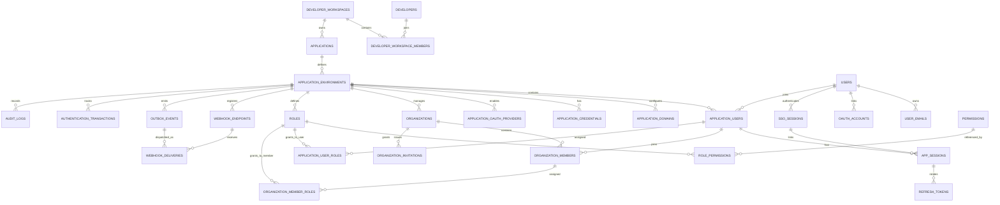

# Target Multi-Tenant Database ER Model

This document defines the canonical PostgreSQL 16 schema introduced in Phase 01, expanding the reference ER architecture with environment isolation (`application_environments`), multi-developer teams (`developer_workspaces`), asymmetric signing keys (`signing_keys`), OIDC transaction state (`authentication_transactions`), organization invitations, and transactional outbox synchronization (`outbox_events`).

## 1. Entity-Relationship Diagram

---

## 2. Table Ownership & Boundary Classification

### Control Plane Tables
| Table | Primary Purpose | Key Uniqueness / Security Constraints |
| --- | --- | --- |
| `developers` | Control Plane operator identities | Unique normalized `email`; isolated from end-user `users` |
| `developer_workspaces` | Team administrative boundary owning applications | Unique `slug` |
| `developer_workspace_members` | Developer-to-workspace RBAC (`owner`, `admin`, `developer`, `viewer`) | PK `(workspace_id, developer_id)` |
| `applications` | Logical product (`Ferrum`, `Elysiar`) | Unique `slug`; FK `workspace_id` |
| `application_environments` | Hard tenant boundary (`development`, `production`) | Unique `(application_id, kind)`; holds `enrollment_policy`, TTLs, branding |
| `application_domains` | Verified domains, CORS `allowed_origins`, exact `redirect_uris` | Scoped by `environment_id`; prod enforces HTTPS & exact URIs |
| `application_credentials` | `pk_test_*`/`pk_live_*` and hashed `sk_test_*`/`sk_live_*` keys | `secret_hash` indexed; plaintext secret never persisted |
| `application_oauth_providers` | Optional per-environment Google/GitHub overrides | `client_secret_encrypted` via AES-256-GCM envelope encryption |

### Global Identity Plane Tables (Not Tenant-RLS-Scoped)
| Table | Primary Purpose | Key Uniqueness / Security Constraints |
| --- | --- | --- |
| `users` | Global immutable identity (`id` = OIDC `sub`) | Monotonic `version BIGINT` trigger; global `status` |
| `user_emails` | Multiple normalized emails per user | Unique `lower(email)` for verified/active ownership |
| `oauth_accounts` | Linked Google/GitHub external identities | `provider TEXT`; unique `(provider, provider_user_id)` |
| `sso_sessions` | Central IdP login sessions powering cross-app SSO | `session_token_hash` unique; stores `authenticated_at`, `amr`, `acr` |

### Tenant-Scoped Tables (Enforced by Composite FKs + `SET LOCAL` RLS)
| Table | Primary Purpose | Cross-Tenant Guardrail |
| --- | --- | --- |
| `application_users` | User membership in a specific environment (`id` = `app_user_id`) | Unique `(environment_id, user_id)` and `(environment_id, id)`; monotonic `version` |
| `app_sessions` | Environment-scoped user sessions | Composite FK `(environment_id, application_user_id)` -> `application_users(environment_id, id)` |
| `refresh_tokens` | RFC 6819 rotated opaque tokens with `family_id` | Composite FK `(environment_id, app_session_id)` -> `app_sessions(environment_id, id)` |
| `organizations` | B2B teams inside an environment | Unique `(environment_id, slug)` and `(environment_id, id)`; monotonic `version` |
| `organization_members` | Membership joining `application_users` and `organizations` | Composite FKs to both `organizations(environment_id, id)` and `application_users(environment_id, id)`; monotonic `version` |
| `organization_invitations` | Expiring single-use hashed invitations | Composite FK `(environment_id, organization_id)`; unique `token_hash` |
| `roles`, `role_permissions`, `application_user_roles`, `organization_member_roles` | Environment-scoped RBAC | All assignments constrained within matching `environment_id` |
| `webhook_endpoints`, `webhook_deliveries`, `outbox_events` | Reliable event sync pipeline | Scoped by `environment_id`; `signing_secret_encrypted` at rest |
| `audit_logs` | Append-only security & operational trail | `environment_id` nullable (null for global/control-plane events); `event TEXT` |

### Platform Infrastructure Tables
| Table | Primary Purpose | Security Invariant |
| --- | --- | --- |
| `signing_keys` | Asymmetric `ES256`/`RS256` keypairs for JWKS & token signing | `private_key_encrypted BYTEA` + `kek_version`; zero plaintext private keys |
| `authentication_transactions` | Short-lived OIDC `/oauth2/authorize` & upstream OAuth PKCE/state/nonce | `authorization_code_hash` single-use, <= 60s expiry |

---

## 3. Core Database Isolation & Sync Invariants

1. **Composite Foreign Keys:** Every child table referencing `application_users`, `app_sessions`, or `organizations` carries `environment_id` in its foreign key constraint so PostgreSQL physically rejects cross-environment links.
2. **Pool-Safe PostgreSQL RLS:** Tenant-scoped queries run inside an explicit transaction using `SET LOCAL app.current_environment_id = $1` (never session-level `SET`), preventing tenant context bleed across pooled SQLx connections.
3. **Monotonic Version Triggers:** `BEFORE UPDATE` triggers increment `NEW.version = OLD.version + 1` on `users`, `application_users`, `organizations`, and `organization_members` so consuming services can enforce `incoming.version >= local.identity_version`.
4. **Redis Namespace Isolation:** Every cache key uses either `idp:global:<purpose>:<id>` or `env:<environment_id>:<purpose>:<id>`.
5. **No Rigid Postgres ENUMs for Extensible Vocabularies:** Replace legacy `oidc_provider` and `auth_audit_event` ENUMs with constrained `TEXT` columns in Phase 01 migrations.

