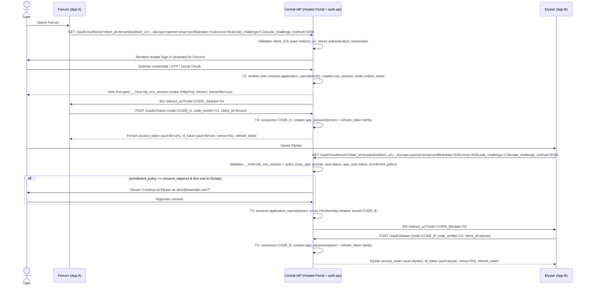
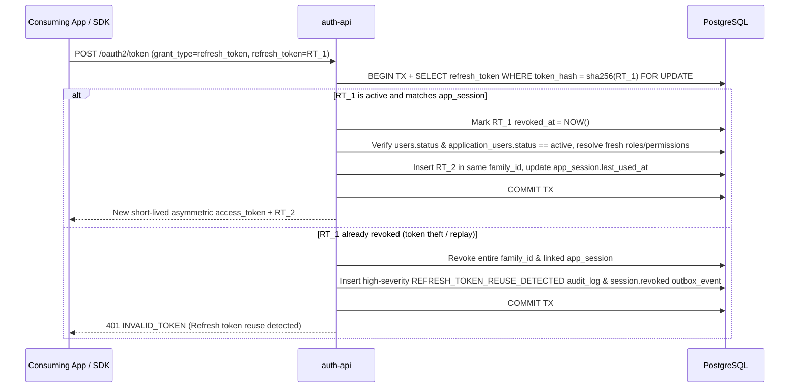
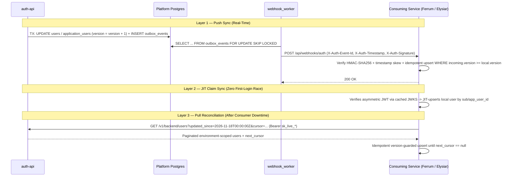

# Authentication, Centralized SSO & Synchronization Sequences

This document defines the canonical runtime interaction flows for cross-application OIDC SSO, refresh token rotation, local vs. global logout, and 4-layer consuming service synchronization.

---

## 1. Initial Sign-In on Ferrum (Application A) + Cross-App SSO into Elysiar (Application B)



---

## 2. Refresh Token Rotation & Reuse Detection (RFC 6819)



---

## 3. Local Logout vs. Global SSO Logout

```mermaid
sequenceDiagram
    actor User
    participant Ferrum as Ferrum (App A)
    participant IdP as Central IdP
    participant Worker as webhook_worker
    participant Elysiar as Elysiar (App B)

    alt Local Logout (Ferrum only)
        User->>Ferrum: Clicks Sign Out
        Ferrum->>IdP: POST /oauth2/revoke (Ferrum refresh_token)
        IdP->>IdP: Revokes Ferrum app_session + family; keeps sso_session & Elysiar app_session active
        Ferrum-->>User: Clears Ferrum session
    else Global Logout (All Apps)
        User->>Ferrum: Clicks Sign Out Everywhere
        Ferrum->>IdP: GET /oauth2/logout?id_token_hint=...&post_logout_redirect_uri=...&global=true
        IdP->>IdP: TX: Revokes sso_session + all linked app_sessions (Ferrum & Elysiar), emits session.revoked outbox_events
        IdP-->>User: Clears __Host-idp_sso_session cookie & redirects to post_logout_redirect_uri
        Worker->>Ferrum: HMAC-signed webhook session.revoked
        Worker->>Elysiar: HMAC-signed webhook session.revoked
    end
```

---

## 4. Four-Layer Consuming Service Synchronization & Downtime Recovery



