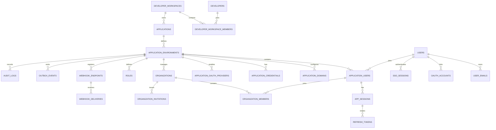
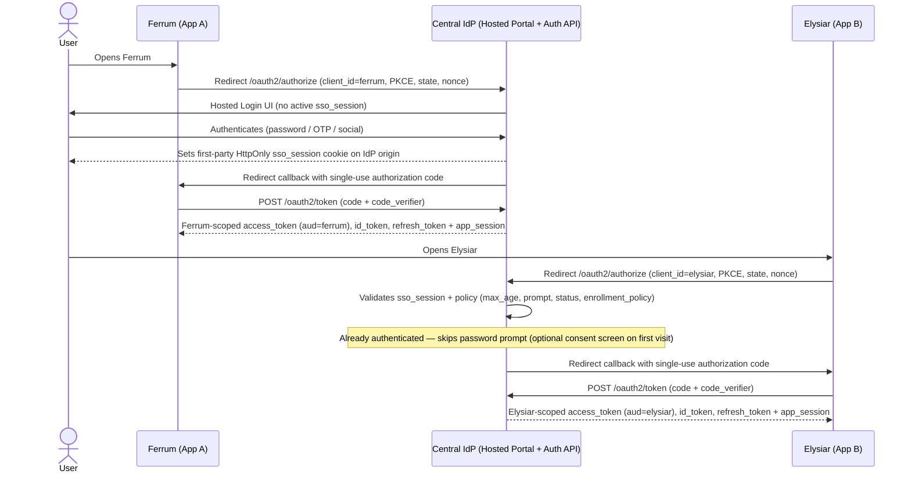

# Identity Infrastructure Platform — Engineering Phases Roadmap

> **Core Product Goal:** Build a reusable, multi-tenant, developer-first Authentication & Central Identity Platform (combining Clerk-style developer ergonomics with a standards-based Central OIDC Identity Provider) so that **whenever you build a new project (e.g., Ferrum, Elysiar, or any future app), you plug this platform in directly—without building auth again—and keep the consuming service's local database reliably synchronized with identity, membership, organization, and session state.**

---

## Architecture Blueprint

### 1. Three-Plane Platform Architecture

| Plane | Audience | Auth Mechanism | Responsibility |
| --- | --- | --- | --- |
| **Identity & OIDC Plane** (`/.well-known/*`, `/oauth2/*`, `/v1/client/*`) | End users, browsers, Hosted Auth Portal, frontend SDKs | IdP `sso_session` cookie (first-party on IdP origin), `pk_test_*` / `pk_live_*`, PKCE, App Access JWTs | Authentication, registration, social OAuth, OIDC Authorization Code + PKCE, centralized SSO, hosted login/consent UI, user self-service |
| **Backend Sync & Management API** (`/v1/backend/*`) | Consuming application backends (Ferrum API, Elysiar API, etc.) | Scoped Secret Keys (`sk_test_*` / `sk_live_*`) | Server-to-server user/membership/org lookups, cursor-based sync & backfill reconciliation, session revocation, privileged mutations |
| **Developer Control Plane** (`/v1/control/*`) | Developers & teams using the Control Plane Dashboard | Developer session (dogfooded or dedicated control-plane auth) | Workspaces, application registration, dev/prod environments, credentials, domains/CORS, OAuth configs, webhooks, audit logs, analytics |

---

### 2. Multi-Tenant Data Model (Expanded from Reference ER Architecture)

Global identities (`users`) are strictly separated from environment-scoped application memberships (`application_users`). Every application has isolated **environments** (`dev`, `prod`) so development test users, keys, domains, organizations, and webhooks never collide with production.

Supporting platform-wide infrastructure tables: `signing_keys` (asymmetric RS256/ES256 keys, envelope-encrypted at rest), `authentication_transactions` (OIDC authorization requests, PKCE challenges, nonces, single-use authorization codes), `permissions`, `role_permissions`, `application_user_roles`, and `organization_member_roles`.

---

### 3. Centralized SSO Flow (Multi-App OIDC)

**Browser Cookie Reality & Integration Modes:**
- **Hosted OIDC Redirect (Canonical Cross-App SSO):** Uses top-level browser redirects so the IdP `sso_session` cookie is strictly first-party (`HttpOnly`, `Secure`, `SameSite=Lax`) and works reliably across completely unrelated domains (`ferrum.com` and `elysiar.io`) despite third-party cookie blocking.
- **Embedded SDK Components (`<SignIn />`):** Supported for app-local authentication when a developer wants fully embedded UI inside a single app, with clear documentation that cross-domain SSO requires IdP redirect handoff.

---

### 4. Four-Layer Service Synchronization Architecture

So any consuming project (Ferrum, Elysiar, etc.) stays accurately synchronized with the Identity Platform without race conditions or drift:

1. **Layer 1 — Push Sync (Transactional Outbox + Signed Webhooks):** Every identity, membership, organization, role, or session mutation atomically writes an `outbox_events` row in the same Postgres transaction. Background workers deliver HMAC-SHA256 signed webhooks with timestamps, unique `event_id`, and monotonic entity `version` numbers (preventing out-of-order overwrites).
2. **Layer 2 — Just-In-Time (JIT) Claim Sync:** Every OIDC ID Token / Access Token and `/oauth2/userinfo` response includes stable `sub` (global user ID), `app_user_id` (per-app membership ID), `email`, `email_verified`, `org_id`, `roles`, `permissions`, and `ver` (identity version). Consuming services can JIT-upsert their local user record on first authenticated request—eliminating webhook race conditions on first login.
3. **Layer 3 — Pull & Reconciliation Sync (Backend Management API):** Paginated, cursor-based endpoints (`GET /v1/backend/users?updated_since=...`, `GET /v1/backend/organizations?updated_since=...`, `GET /v1/backend/events?after=...`) allow any consuming service to bootstrap a fresh database, recover from prolonged webhook downtime, or run scheduled drift reconciliation.
4. **Layer 4 — Revocation & Session Sync:** Short-lived asymmetrically signed access tokens (verified statelessly via JWKS), OIDC Back-Channel Logout / `session.revoked` webhooks, and optional high-sensitivity session introspection keep access revocations tight across services.

**Golden Rule for Consuming Services:** Never key local application tables on mutable email addresses. Always key local projections on immutable `sub` (global identity) or `app_user_id` (environment membership) and guard upserts with `incoming.version >= local.identity_version`.

---

## Master Phase Index

| Phase | Document | Focus | Key Prerequisites |
| --- | --- | --- | --- |
| **Phase 00** | [phase-00-architecture-and-foundations.md](./phase-00-architecture-and-foundations.md) | Architecture specs, ADRs, API contracts, existing codebase defect fixes | Current repository baseline |
| **Phase 01** | [phase-01-multi-tenant-identity-and-schema.md](./phase-01-multi-tenant-identity-and-schema.md) | Multi-tenant PostgreSQL schema, environments, composite FKs, RLS, tenant-isolation tests | Phase 00 |
| **Phase 02** | [phase-02-application-registry-and-credentials.md](./phase-02-application-registry-and-credentials.md) | Application registry, dev/prod environments, `pk_*`/`sk_*` keys, dynamic CORS/domains, Dashboard shell | Phase 01 |
| **Phase 03** | [phase-03-tokens-and-core-auth-engine.md](./phase-03-tokens-and-core-auth-engine.md) | Asymmetric RS256/ES256 signing & JWKS, multi-tenant auth engine, upstream social OAuth, app sessions, RBAC | Phase 02 |
| **Phase 04** | [phase-04-oidc-sso-and-hosted-portal.md](./phase-04-oidc-sso-and-hosted-portal.md) | OIDC Provider endpoints, central `sso_sessions`, policy engine, Hosted Auth & Consent UI, local/global logout | Phase 03 |
| **Phase 05** | [phase-05-service-sync-and-webhooks.md](./phase-05-service-sync-and-webhooks.md) | Transactional outbox, SSRF-safe webhook delivery workers, event schemas, Backend Sync/Reconciliation API | Phase 03 & Phase 04 |
| **Phase 06** | [phase-06-sdks-and-framework-integrations.md](./phase-06-sdks-and-framework-integrations.md) | `@secure-auth/core`, SvelteKit, React, Next.js (Edge-compatible), webhook/sync helpers, starter sync kits | Phase 04 & Phase 05 |
| **Phase 07** | [phase-07-developer-dashboard.md](./phase-07-developer-dashboard.md) | Full Developer Control Plane UI (users, sessions, webhooks, domains, providers, team roles, overview) | Phase 02 – Phase 05 |
| **Phase 08** | [phase-08-organizations-and-advanced-authz.md](./phase-08-organizations-and-advanced-authz.md) | Organizations, invitations, custom roles/permissions, account linking/unlinking, org sync events | Phase 05 & Phase 07 |
| **Phase 09** | [phase-09-observability-and-analytics.md](./phase-09-observability-and-analytics.md) | Multi-tenant OTel/Prometheus/Grafana/Loki/Tempo telemetry, per-app usage & auth analytics | Phase 05 & Phase 07 |
| **Phase 10** | [phase-10-security-reliability-and-testing.md](./phase-10-security-reliability-and-testing.md) | OWASP ASVS verification, abuse/SSRF/isolation audits, k6 load/soak tests, failover & DR drills | Phase 08 & Phase 09 |
| **Phase 11** | [phase-11-infrastructure-and-deployment.md](./phase-11-infrastructure-and-deployment.md) | Terraform, hardened Docker images, K8s/Helm/ArgoCD GitOps, worker deployments, secret & key ops | Phase 10 |
| **Phase 12** | [phase-12-docs-dogfooding-and-launch.md](./phase-12-docs-dogfooding-and-launch.md) | Docs site, CLI, dual-app dogfooding (`Ferrum` + `Elysiar`), usage metering, billing hooks, public release | Phase 11 |

---

## Cross-Cutting Engineering & Quality Gates

Every phase from **Phase 01 onward** must satisfy these standing gates before being marked complete:

1. **Incremental Tenant Isolation Tests:** Cross-application and cross-environment isolation tests are written *in the same phase* that introduces each new table, endpoint, or worker—never deferred to Phase 10.
2. **Transactional Integrity:** Multi-step state mutations (user + membership + role + outbox event) run inside explicit PostgreSQL transactions; errors are never silently discarded.
3. **Zero Shared Secret Leakage:** Secret keys (`sk_*`), OAuth client secrets, webhook signing secrets, and asymmetric private keys are never stored in plaintext or exposed to browser responses or logs.
4. **Backward-Compatible Contracts:** API and event schemas are explicitly versioned (`v1`) and validated against automated contract tests.
5. **Auditability:** Every authentication, credential, permission, membership, and webhook configuration mutation writes a structured audit record.

---

## Final Product Acceptance Criteria

The platform is production-ready for plugging into any new project when:

1. A brand-new project can be registered in the Developer Dashboard (dev + prod environments) and integrated with working authentication in under 15 minutes using the SDK or standard OIDC.
2. Global identities (`users`) and environment-scoped memberships (`application_users`) are cleanly separated, with database- and application-enforced tenant isolation verified by automated tests.
3. Two independent applications (`Ferrum` and `Elysiar`) authenticate via the Central IdP with seamless OIDC SSO (`sso_sessions`), isolated per-app sessions (`app_sessions`), isolated `aud`-scoped asymmetric JWTs, and working local + global logout.
4. Consuming services stay reliably synchronized via all four layers: transactional-outbox HMAC-signed webhooks, JIT token claims, paginated cursor reconciliation APIs, and revocation propagation.
5. SvelteKit, React, and Next.js (including Edge Middleware) SDKs pass unit, SSR, hydration, and end-to-end integration suites.
6. Organizations, invitations, and custom application/organization RBAC work end-to-end and emit synchronized webhook events.
7. Observability dashboards, alerts, security audits (OWASP ASVS, SSRF, replay, brute-force), load budgets, CI/CD pipelines, and backup/recovery runbooks are verified in staging and production.

